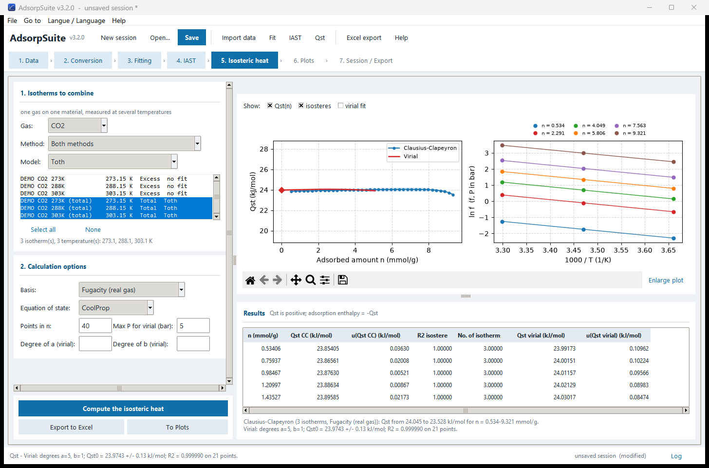
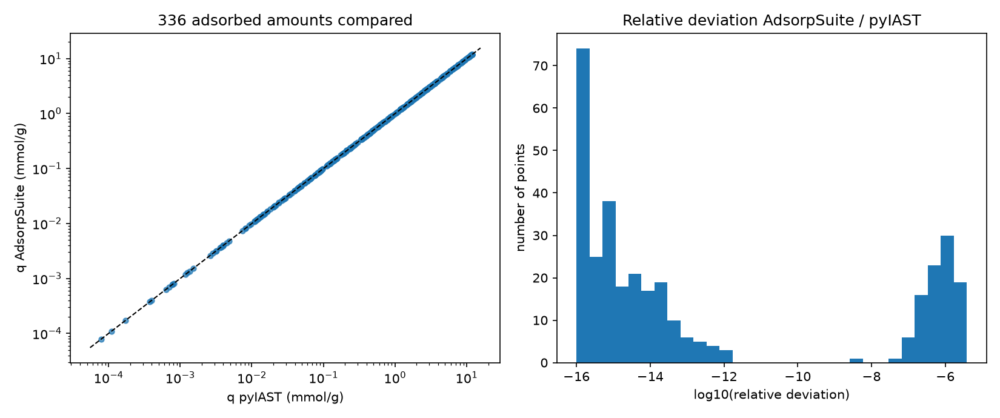
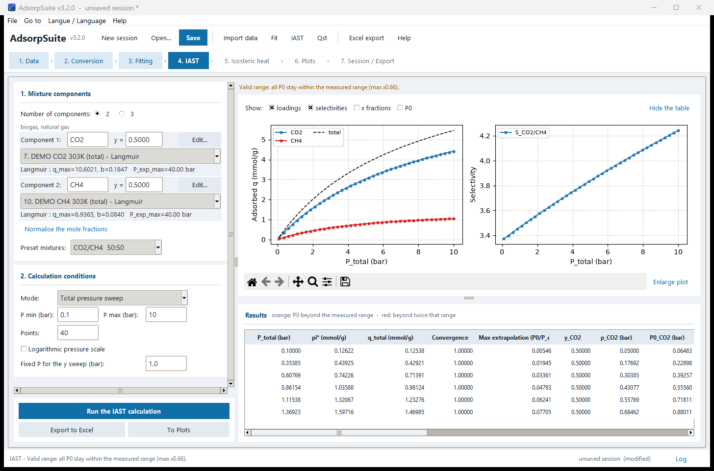
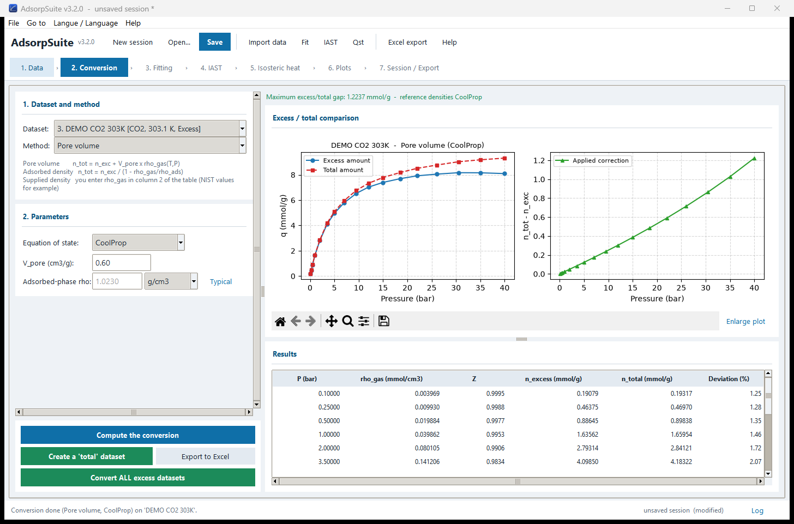

# AdsorpSuite

Free, open-source desktop application for high-pressure gas adsorption: excess-to-absolute conversion, isotherm fitting, IAST mixture predictions and isosteric heat, in a graphical interface and without writing code. Interface in English or French.

[](https://doi.org/10.5281/zenodo.22011512)
[](https://www.python.org/downloads/)
[](https://opensource.org/licenses/MIT)



## Download

**Windows:** download the `.exe` file from the [latest release](https://github.com/stevencompere/AdsorpSuite/releases/latest) and double-click it. No Python installation is needed and CoolProp is included. The program takes about 10 seconds to open.
Windows may show a SmartScreen warning because the program is not code-signed: click *More info*, then *Run anyway*.

**From source (Windows, macOS, Linux):**

```bash
pip install -r requirements.txt
python AdsorpSuite.py            # add --lang=en or --lang=fr to force the language
```

## Who is it for?

AdsorpSuite does not replace scripting libraries such as [pyIAST](https://github.com/CorySimon/pyIAST) or [pyGAPS](https://github.com/pauliacomi/pyGAPS). It is meant for experimentalists who want the whole high-pressure workflow in one window: from raw excess isotherms to absolute uptakes, fitted models, IAST selectivities and isosteric heats, with checks that flag the usual pitfalls (extrapolated IAST predictions, near-critical gas densities, points measured above the saturation pressure).

## What it does

| Tab | Content |
|---|---|
| 1. Data | Import one or several .xlsx/.xls/.csv files (gas, temperature and sample read from file names, with a summary to check before import), paste from Excel, automatic unit conversion |
| 2. Conversion | Excess → absolute uptake with bulk densities from CoolProp, NIST reference tables or Peng–Robinson; warnings near the critical point and above the saturation pressure |
| 3. Fitting | Langmuir, dual-site Langmuir, Freundlich, Sips, Toth, Dubinin–Radushkevich, Dubinin–Astakhov; multi-start fitting, bootstrap confidence intervals, parameter correlation, AIC/AICc/BIC ranking, residuals |
| 4. IAST | Binary and ternary mixtures, pressure or composition sweeps, preset mixtures (CO2/CH4, CO2/N2, CO2/H2, CH4/N2, CH4/H2, C2H2/CO2, C2H2/C2H4, C2H4/C2H6, C3H6/C3H8, Xe/Kr), components suggested from the fits and checked before the calculation, extrapolation diagnostics |
| 5. Isosteric heat | Clausius–Clapeyron at constant loading from the fitted models (fugacity or pressure basis, no extrapolation, standard uncertainty from three or more temperatures) and virial equation (Qst at zero coverage) |
| 6. Plots | Customisable figures, export to PNG/PDF/SVG/EPS/TIFF |
| 7. Session / Export | One-file sessions (.adsp, JSON), multi-sheet Excel export, Origin-ready workbooks (Long Name / Units) |

Supported gases: CO2, CH4, H2, D2, N2, O2, Ar, CO, He, Ne, Kr, Xe, C2H2, C2H4, C2H6, C3H6, C3H8, n-C4H10, i-C4H10, NH3, H2S, SO2, N2O, SF6, H2O.

## Validation

- **IAST compared with pyIAST** (Simon, Smit & Haranczyk, *Comput. Phys. Commun.* 200 (2016) 364–380). Both codes received the same pure-component isotherms and computed 162 binary and ternary mixtures (336 adsorbed amounts). Largest relative deviation: 1.3 × 10⁻¹² for Langmuir, dual-site Langmuir and ternary Langmuir mixtures, and 3.9 × 10⁻⁶ for Toth, Sips and Dubinin–Astakhov, where pyIAST works on an interpolated table. A Langmuir fit of the same noisy data gives parameters that agree within 2 × 10⁻⁵. The script, the full report and every compared point are in [`validation/`](validation/).
- **Internal self-test:** 49 checks, including analytical vs. numerical spreading pressures, thermodynamic consistency of IAST, reference values computed with pyIAST, reference gas densities, fugacity coefficients, and isosteric heats recovered from isotherms with a known heat. Run it from the *Session / Export* tab or with `AdsorpSuite.exe --selftest`.
- **Every release** is built and tested automatically on Windows (self-test of the executable, comparison with pyIAST): see [`.github/workflows/build-windows.yml`](.github/workflows/build-windows.yml).

<p align="center">
  
</p>

## Screenshots

All screenshots use synthetic demonstration data.

| IAST | Excess-to-absolute conversion |
|---|---|
|  |  |

## Citation

If you use AdsorpSuite in your research, please cite:

```
@software{compere_adsorpsuite_2026,
  author    = {Compère, Steven},
  title     = {AdsorpSuite: Comprehensive Adsorption Isotherm Analysis, Excess-to-Absolute Conversion, and IAST Mixture Modeling},
  year      = {2026},
  publisher = {Zenodo},
  version   = {v3.2.0},
  doi       = {10.5281/zenodo.22011512},
  url       = {https://doi.org/10.5281/zenodo.22011512}
}
```

## Author & contact

Steven Compère (PhD, Materials Chemistry), ORCID [0009-0006-3474-8748](https://orcid.org/0009-0006-3474-8748).
Bug reports and feature requests: [GitHub Issues](https://github.com/stevencompere/AdsorpSuite/issues).

## What's new in 3.2.0

Usability release: the numerical methods are unchanged.

- IAST: the components are suggested from the fits (one per gas, absolute isotherms, same temperature) and checked before the calculation (wrong gas, excess isotherm, same fit used twice, different temperatures). They are now saved in the session.
- Everything fits in a 1150 × 720 window: Conversion, IAST and Isosteric heat tabs in two columns, status bar always visible, message log on demand.
- A single import: gas, temperature and sample are read from the file names (for example `ZTC850-CO2_303K.xlsx`), rows to check are highlighted, dataset names are unique.
- Fitting: an absolute ("total") dataset is offered first, and batch fitting skips the excess datasets that have already been converted.
- Plots tab: *Add* button, and a hint when the figure is empty.
- The window size is remembered without exceeding the screen; changing the language reopens the current session.
- French interface displayed with its accents.
- Fixes: a value edited or pasted in the data table is saved automatically (it was lost when switching to another dataset, saving the session or quitting); a dataset typed after *New empty dataset* no longer overwrites the dataset opened before; the isosteric heat uses the current temperature of each dataset; a failed save no longer removes the existing session file; units of pi* and P0/P_exp in the Origin export; changing the language no longer crashes the Windows executable.

## What's new in 3.1.0

- English / French interface (menu *Langue / Language*).
- New *Isosteric heat* tab: Clausius–Clapeyron (fugacity basis) and virial methods.
- New gases (C2H2, C3H6, i-C4H10, SF6, N2O, D2) and preset mixtures for common separations.
- Warning when measured points lie above the saturation pressure (for example CO2 at 273 K above 34.9 bar), where the bulk fluid is liquid.
- Batch conversion asks for one pore volume per sample; preset mixtures pick fits at the same temperature and on the same sample.
- IAST validated against pyIAST; reference values added to the self-test.
- Stand-alone Windows executable with CoolProp included.

## License

MIT, see [LICENSE](LICENSE).
